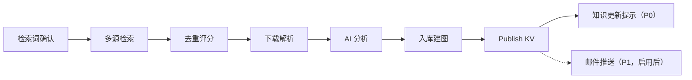

# UI Construction 工作台附录

文档版本：v1.3
更新日期：2026-10-16
来源：`03_ui_workspace.md` v1.18 第 9 章；保留 P 编号，按模块拆分。

本附录与 [UI 主文](03_ui_workspace.md) 具有相同 UI 规范效力；需求含义和分期以 [01](01_functional_requirements.md) 为准，状态与不变量以 [02](02_domain_core.md) 及其专题附录为准。详细交互在本附录单点维护，主文只保留跨模块约束与索引。

## 变更记录

| 版本 | 日期 | 内容 |
| --- | --- | --- |
| v1.2 | 2026-10-16 | 同步已采纳构建状态机、候选四态、无变化成功展示及取消/恢复竞争；保留 P1 分期 |
| v1.1 | 2026-10-16 | 同步 paused ConstructionRun 的占槽说明及继续、取消、重跑所对应的实例行为 |

## 1. Shell 组合与模块契约

本模块使用 [主文 Shell](03_ui_workspace.md#shell-composition) 的唯一对象选择栏与信息面板。P15–P21、P43/P44 是主体区内的视图，不能各自再生成全局顶栏或 Project 对象列表。历史 Construction Run 是 Construction Workspace 内的选择，不升为 Shell 顶层对象。

| 视图 | 主体区 | Shell Object Info | 默认与展开行为 |
| --- | --- | --- | --- |
| P15 长期配置容器 | 当前构建摘要、待处理事项；检索词配置、补充请求、历史运行分区切换 | 配置摘要；选中历史 Run 后显示该 Run 的状态与快照 | 默认突出当前任务/待确认项；完整配置、历史、诊断按需打开 |
| P16/P43 启动与检索词确认 | 当前启动输入或检索词编辑 | 配置缺失、确认状态摘要 | 启动只确认当前操作所需范围 |
| P17/P44/P18–P20 运行步骤 | 单个选中 Run 的步骤条及当前步骤内容；论文列表为步骤内局部列表 | 该 Run 的状态、等待项、快照和诊断入口 | 步骤切换不启动、跳过或重跑任务；失败项按需展开 |
| P21（P1） | 已发布结果的推送预览与发送状态 | 推送结果摘要 | P0 不展示步骤或发送入口 |

模块上下文至少包含当前 Project、Construction Workspace、选中 Run（如有）、运行输入快照与候选/已发布标识；本轮快照与下轮配置不得混用。选择 Run 时主体与 Object Info 同步，旧请求返回不得覆盖新选择。资产查看通过 [P30](03-04_ui_shared_interactions_appendix.md#p30) 打开；候选预览留在构建主体区，不伪装成已发布证据。

P15 线框展示可用区域，不要求在同一屏展开全部区域。窄屏按“摘要/待办、当前视图、按需详情”组织，采用主文的单面板抽屉规则。配置缺失、占槽、无权限、失败和人工内容保护沿用 [共用交互](03-04_ui_shared_interactions_appendix.md#p36)，操作最终由应用用例校验。

自动更新开关和检索词策略属于 FR-020 的 P0 配置；系统自动调度属于 FR-009 的 P1。P0 可保存策略，但摘要必须显示“调度未启用”，不展示虚构的下次运行时间或自动 Run。启用 P1 后才显示调度时间与自动运行记录。P16 只显示本轮实际生效的配置摘要；P1 平台硬限制、SMTP 推送配置仅在对应能力启用且本轮使用时展示。

## 2. 页面线框

<a id="p15"></a>

### P15 Construction Workspace

本轮基线和输入快照单独展示；运行期间配置修改默认下一轮生效。上传、待采纳修订显示“已接收／待纳入／处理中／已发布”，不能以“上传成功”暗示已成为研究证据。同一项目构建槽被占用（含暂停）时，允许保存配置、接收材料和登记下轮请求，不启动第二个写入者；显示占槽任务、负责人和等待原因。显式继续恢复同一 Run，显式取消清除其占槽，显式重跑使旧 Run cancelled，记录被替代原因及关联新 Run，撤销旧写资格后由新 Run 安全接管原槽；交接中不向第三方放槽，排队新 Run 未获资格前不占槽；控件仍受既定权限和功能分期约束。

运行摘要分别展示 Run 状态、当前 attempt 及候选状态。局部 attempt 失败不能显示整轮失败；Run failed 则保留失败诊断。资源忙时 queued 不占槽；排队后因权限或原基线不可执行时展示 failed 和原因，未通过提交检查的输入留在 draft。P1 恢复按[运行恢复附录](02-04_run_recovery_appendix.md)检查可信断点，允许时原 Run 经 queued 重新获槽并创建新 attempt；需要改变输入或基线、候选已废弃/清理或必须从头构建时说明需新建 Run，不能承诺原地恢复。P1 放弃恢复操作保留 failed，另显“已放弃恢复”和清理结果，不显示 cancelled。

P1 等待用户的 Run 可暂停；继续只恢复原 waiting_user 和原等待项，不等于确认。暂停、恢复和通用重跑的入口仍按原分期提供。取消尚未完成或提交结果不明时显示正在核验，不提前显示已取消；发布/no_change 完成先成立则保留成功，取消先撤销资格则不得再完成。

候选预览与已发布知识明确区分。手动入库确认绑定具体预览修订；确认入库受理前候选内容实质变化需说明原因并重新确认；受理后锁定不再编辑。人工修改冲突保留双方内容，展示差异及最后编辑者；自动构建不能借自动确认覆盖人工成果，按规则跳过、降级或局部失败并留下待处理记录。

```text
┌────────────────────────────────────────────────────────────────────────────┐
│ Construction Workspace      Project A | default KV: KV-12 | active CR-018 │
├────────────────────────────────────────────────────────────────────────────┤
│ 构建状态摘要                                                               │
│ 论文 128 | 检索词 12 | 自动更新词 6 | 最近成功 CR-017 | 候选版本构建中       │
│ [启动手动 Run]  [生成检索词]  [手动添加检索词]  配置缺失时显示修复入口     │
├──────────────────────────────┬─────────────────────────────────────────────┤
│ 检索词集合                    │ 自动更新与历史运行                           │
│ ┌──────────────────────────┐ │ 自动更新摘要                                 │
│ │ term-01                  │ │ ┌─────────────────────────────────────────┐ │
│ │ 关键词 / 布尔式 / 排除词  │ │ │ enabled terms: 6 | 调度: P1 未启用  │ │
│ │ 理由 / 覆盖方向           │ │ │ datasource: arXiv ok | OA ok | ADS err │ │
│ │ 自动更新 [on]             │ │ └─────────────────────────────────────────┘ │
│ │ 数据源策略 [arXiv OA]     │ │                                             │
│ │ 状态: 人工确认            │ │ 历史 Construction Runs                     │
│ │ [编辑草稿] [确认修改]     │ │ ┌───────┬────────┬─────────┬────────────┐ │
│ └──────────────────────────┘ │ │ Run   │ 类型    │ 状态     │ 操作        │ │
│ ┌──────────────────────────┐ │ │ CR-018│ manual │ running │ 查看状态    │ │
│ │ term-02                  │ │ │ CR-017│ manual │ success │ 查看结果    │ │
│ │ 自动更新 [off]            │ │ │ CR-016│ manual │ failed  │ 查看诊断    │ │
│ └──────────────────────────┘ │ └───────┴────────┴─────────┴────────────┘ │
├──────────────────────────────┴─────────────────────────────────────────────┤
│ 补充论文 / Project 资料请求队列                                            │
│ [新增请求] DOI / arXiv ID / URL / PDF / P0 资料文件                        │
│ ┌────────┬──────────┬────────────┬────────────┬─────────────────────────┐ │
│ │ 来源   │ 提交值    │ 解析状态     │ 确认状态     │ 下一步                  │ │
│ │ DOI    │ 10.x/abc │ 待确认       │ 用户确认中   │ 查看候选元数据          │ │
│ │ PDF    │ file.pdf │ 元数据不足   │ 待补充       │ 补充标题 / 作者 / 年份  │ │
│ │ URL    │ site/... │ 已转候选     │ 已确认       │ 在下次 Run 中进入筛选   │ │
│ └────────┴──────────┴────────────┴────────────┴─────────────────────────┘ │
└────────────────────────────────────────────────────────────────────────────┘
```

Construction Workspace 是每个 Project 唯一的长期构建配置容器，不是一次运行，也不直接生成 Knowledge Version。补充论文/资料请求先形成待确认记录，不直接写入 ProjectPaper/ProjectMaterial，也不直接挂到某个当前 Run。P0 支持单条论文补充及 FR-023 支持格式的单文件资料上传；资料确认前至少具备标题与 content_format，重要摘要、处理状态和来源 Run 可追踪，按 FR-021–026 进入构建链路。批量上传和数据表为 P1，多媒体为 P2。

<a id="p43"></a>

### P43 检索词生成审核

```text
┌────────────────────────────────────────────────────────────────────────────┐
│ 检索词生成审核                                      [接受选中] [弃用选中]│
├────────────────────────────────────────────────────────────────────────────┤
│ 生成来源: Project 主题 / 最近论文 / 用户补充范围                          │
│ ┌────┬──────────────┬──────────────┬────────────┬────────────┬──────────┐ │
│ │ 选 │ 关键词        │ 布尔 / 排除词 │ 数据源策略  │ 理由        │ 状态      │ │
│ ├────┼──────────────┼──────────────┼────────────┼────────────┼──────────┤ │
│ │ ☑  │ term-01      │ A AND B -C   │ arXiv OA   │ 覆盖方向 1  │ 候选      │ │
│ │ ☐  │ term-02      │ D OR E -F    │ ADS        │ 覆盖方向 2  │ 已编辑    │ │
│ └────┴──────────────┴──────────────┴────────────┴────────────┴──────────┘ │
│ 当前项: [编辑关键词] [编辑数据源] 自动更新 [on/off] [接受] [弃用]           │
└────────────────────────────────────────────────────────────────────────────┘
```

生成审核只在 Construction Workspace 内出现。候选词被接受后进入长期检索词列表；被弃用的候选保留最小记录用于避免重复建议。批量接受、弃用和人工编辑均必须通过应用用例校验。

<a id="p16"></a>

### P16 手动 Construction Run 启动

```text
┌──────────────────────────────────────────────────────────────┐
│ 启动 Construction Run                                  [×]   │
├──────────────────────────────────────────────────────────────┤
│ 检索词                                                       │
│ ☑ term-01   ☑ term-02   ☐ term-03   ☑ term-04               │
│                                                              │
│ 时间范围        ┌──────────────┐ 至 ┌──────────────┐         │
│ 返回上限        ┌──────────────┐                              │
│                                                              │
│ 配置快照                                                       │
│ ┌──────────────────────────────────────────────────────────┐ │
│ │ LLM source / model | sources | 输入范围 / 参数        │ │
│ └──────────────────────────────────────────────────────────┘ │
│                                                              │
│ [取消]                                           [启动]       │
└──────────────────────────────────────────────────────────────┘
```

<a id="p17"></a>

### P17 Construction Run

```text
┌────────────────────────────────────────────────────────────────────────────┐
│ CR-018 manual running  KV output: pending          [取消] [查看日志]      │
├────────────────────────────────────────────────────────────────────────────┤
│ ① 检索词  ② 多源检索  ③ 去重评分  ④ 下载解析  ⑤ AI 分析  ⑥ 入库建图          │
├──────────────────────┬─────────────────────────────────────────────────────┤
│ Step                 │ 当前步骤                                            │
│ ① done              │ ┌─────────────────────────────────────────────────┐ │
│ ② done              │ │ 去重评分                                         │ │
│ ③ waiting           │ │ 输入: candidates 183 | existing 42              │ │
│ ④ locked            │ │ 输出: valid 61 | invalid 80 | duplicate 42      │ │
│ ⑤ locked            │ │ 等待: 用户确认有效论文                           │ │
│ ⑥ locked            │ │ 错误: ADS timeout                                │ │
│                     │ └─────────────────────────────────────────────────┘ │
│                      │                                                     │
│                      │ ┌──────────────┬────────┬──────┬────────┬────────┐ │
│                      │ │ 标题          │ 来源   │ 分数 │ 状态    │ 操作    │ │
│                      │ ├──────────────┼────────┼──────┼────────┼────────┤ │
│                      │ │ paper A      │ arXiv  │ 9.1  │ valid  │ 详情 调整│ │
│                      │ │ paper B      │ OA     │ 5.4  │ invalid│ 详情 调整│ │
│                      │ └──────────────┴────────┴──────┴────────┴────────┘ │
│                      │                                                     │
│                      │ [调整有效性] [确认并继续]                            │
└──────────────────────┴─────────────────────────────────────────────────────┘
```

<a id="p44"></a>

### P44 Construction Run / 多源检索结果

```text
┌────────────────────────────────────────────────────────────────────────────┐
│ CR-018  多源检索                                      [取消] [查看日志]   │
├────────────────────────────────────────────────────────────────────────────┤
│ 检索词 4 | 数据源 3 | 返回 183 | 失败 1 | 限流 1                         │
│ ┌──────────┬────────┬────────────────────┬──────┬────────┬────────────┐ │
│ │ 检索词    │ 数据源 │ 查询式              │ 返回 │ 状态    │ 诊断 / 操作 │ │
│ ├──────────┼────────┼────────────────────┼──────┼────────┼────────────┤ │
│ │ term-01  │ arXiv  │ A AND B -C          │ 92   │ done   │ 查看       │ │
│ │ term-01  │ ADS    │ A AND B -C          │ 0    │ limited│ 查看诊断   │ │
│ │ term-02  │ OA     │ D OR E -F           │ --   │ failed │ 查看诊断   │ │
│ └──────────┴────────┴────────────────────┴──────┴────────┴────────────┘ │
│ [确认可用结果并继续]                                                       │
└────────────────────────────────────────────────────────────────────────────┘
```

本视图只展示检索执行结果和诊断入口，不提供跳过阶段、手动改写返回结果或绕过数据源策略的操作。

<a id="p18"></a>

### P18 Construction Run / 下载解析

```text
┌────────────────────────────────────────────────────────────────────────────┐
│ CR-018  下载解析                                                    [取消]│
├────────────────────────────────────────────────────────────────────────────┤
│ 成功 48    失败 7    摘要降级 6    待处理 3                              │
├────────────────────────────────────────────────────────────────────────────┤
│ ┌──────────────┬────────────┬────────────┬────────────┬────────────────┐ │
│ │ 标题          │ PDF        │ 解析        │ 降级文本     │ 操作            │ │
│ ├──────────────┼────────────┼────────────┼────────────┼────────────────┤ │
│ │ paper A      │ ok         │ ok         │ no         │ 打开            │ │
│ │ paper B      │ failed     │ --         │ abstract   │ 查看诊断        │ │
│ └──────────────┴────────────┴────────────┴────────────┴────────────────┘ │
│                                                                            │
│ [确认并继续]                                                               │
└────────────────────────────────────────────────────────────────────────────┘
```

<a id="p19"></a>

### P19 Construction Run / AI 分析

```text
┌────────────────────────────────────────────────────────────────────────────┐
│ CR-018  AI 分析                                                      [取消]│
├──────────────────────┬─────────────────────────────────────────────────────┤
│ 论文列表              │ 分析编辑                                            │
│ paper A              │ 一句话总结                                          │
│ paper B              │ ┌─────────────────────────────────────────────────┐ │
│ paper C              │ └─────────────────────────────────────────────────┘ │
│                      │ 亮点                                                │
│                      │ ┌─────────────────────────────────────────────────┐ │
│                      │ └─────────────────────────────────────────────────┘ │
│                      │ 相关性要点                                          │
│                      │ ┌─────────────────────────────────────────────────┐ │
│                      │ └─────────────────────────────────────────────────┘ │
│                      │ 方法与创新                                          │
│                      │ ┌─────────────────────────────────────────────────┐ │
│                      │ └─────────────────────────────────────────────────┘ │
│                      │ [重新生成] [保存人工修改] [确认]                   │
└──────────────────────┴─────────────────────────────────────────────────────┘
```

<a id="p20"></a>

### P20 Construction Run / 入库建图

候选状态显示准备中、待发布、已发布或已废弃。待发布不代表已经发布：确认必须绑定具体候选修订，必要资产、向量及图谱完整且无待续连工作后才就绪；确认受理前实质修改退回准备中并撤销旧确认；确认入库受理后锁定，不提供编辑，发布仍需重新校验权限、基线、写资格、修订及完整性。普通关系和属性（最新、固定文献范围、被引用、撤稿提示）不显示为版本生命周期状态。

结果区区分“成功：已发布新版本”（published）和“成功：检查完成，无知识变化”（no_change）。后者展示核验的既有版本、检查时间、范围及诊断，默认版本不变，不触发升级提示或空邮件；候选已废弃的原因显示“核验无变化”，不能把该候选收尾显示为 Run 失败。零新增、检索失败或首次尚无版本都不能自动展示无变化成功；no_change 同样要通过完成前的当前资格、基线与完整性核验。仅正文、分析、范围、引用或图谱发生变化时仍属于知识变化。

下方线框展示有变化发布路径；no_change 结果将 KV 发布项替换为“无需发布，核验版本 KV-…”。通知失败独立显示，保留成功成果。

```text
┌────────────────────────────────────────────────────────────────────────────┐
│ CR-018  入库建图                                                    [取消]│
├────────────────────────────────────────────────────────────────────────────┤
│ 即将入库 valid 61 | 跳过 existing 42 | 风险 3                             │
│ ┌──────────────────────────────────────────────────────────────────────┐   │
│ │ 论文入库     pending / running / done / failed                        │   │
│ │ 向量切分     pending / running / done / failed                        │   │
│ │ Graph 更新   pending / running / done / failed                        │   │
│ │ KV 发布      pending / running / done / failed                        │   │
│ └──────────────────────────────────────────────────────────────────────┘   │
│                                                                            │
│ [开始入库] [查看失败项] [打开论文库] [打开 Graph]                          │
└────────────────────────────────────────────────────────────────────────────┘
```

<a id="p21"></a>

### P21 Construction Run / 邮件推送（P1 参考）

```text
┌────────────────────────────────────────────────────────────────────────────┐
│ CR-018  邮件推送                                                        │
├────────────────────────────────────────────────────────────────────────────┤
│ 新增有效论文 24 | 未推送 24 | 收件人 2 | 空邮件保护: 强制启用            │
│ ┌──────────────────────────────────────────────────────────────────────┐   │
│ │ Project 名称                                                         │   │
│ │ 有效论文统计                                                         │   │
│ │ 论文摘要列表 / 来源检索词 / 来源数据源                                │   │
│ └──────────────────────────────────────────────────────────────────────┘   │
│                                                                            │
│ [预览] [发送]  无可推送论文时跳过发送并记录原因                         │
└────────────────────────────────────────────────────────────────────────────┘
```

无未推送有效论文时不得发送空邮件；系统只记录跳过原因和可诊断状态。

<a id="p40"></a>

### P40 Construction Run 流程



## 3. 更改记录

| 版本 | 日期 | 变更摘要 |
| --- | --- | --- |
| v1.0 | 2026-10-16 | 从 UI v1.18 拆分，保留页面标识与交互边界，补充布局组合并清理分期残留 |

## 本轮已采纳的资产交互边界

- 论文和 ProjectMaterial 在确认入库受理前可编辑候选，之后显示只读原因；发布成功后知识内容只读。修改已入库内容通过“移除关联—发布成功—新导入”，提示两个版本之间暂不包含该资产；不展示已入库元数据、全文、分析、评分修订入口。失败保留人工草稿和诊断，P0 引导新建构建准备候选，不开放原 Run 恢复。
- 单条、批量和全部移除使用同一个风险预览与确认：显示具体集合/修订、旧引用仍保留、非物理删除、被终止的实际冲突构建。同次确认授权终止已预览冲突运行并自动受理移除构建；新冲突或范围变化刷新预览，不要求用户另走取消流程，也不取消未预览或无关运行。
- 受理后显示待移除/处理中，发布成功才显示移除完成；失败或取消不隐藏原正式资产。真正清空发布空版本，仍有资料不算空库；空版可浏览并新建 Research/Review，清楚提示无项目证据，可导入或显式选用非空历史版本。
- 返回检索仅在同 Run 筛选等待点提供“追加已确认检索词”，原词、来源、时间范围、总预算、基线及配置不变，仅用剩余额度；受影响候选重处理并保留人工决定，入库确认后隐藏该操作。
- 同 DOI 重新导入沿用论文身份，当前仍关联时提示先移除；自动检索不恢复人工排除，显式重新纳入需重新确认，不继承旧确认。

本次修订 v1.3（2026-10-16）：落实 R1-A 至 R4-A 与人工补充裁决：学术引用建议、轻量稿件编辑及下载、风险确认移除、空版本可新建研究、论文及资料入库后只读、筛选等待点追加词。仅设计同步，未实现或运行验收。
