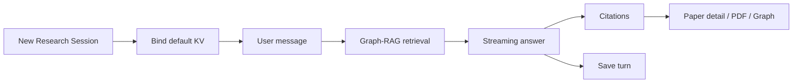

# UI Research / Review 工作台附录

文档版本：v1.2
更新日期：2026-10-16
来源：`03_ui_workspace.md` v1.18 第 9 章；保留 P 编号，按模块拆分。

本附录与 [UI 主文](03_ui_workspace.md) 具有相同 UI 规范效力；需求含义和分期以 [01](01_functional_requirements.md) 为准，状态与不变量以 [02](02_domain_core.md) 及其专题附录为准。详细交互在本附录单点维护，主文只保留跨模块约束与索引。

## 1. Shell 组合与模块契约

本模块遵循 [主文 Shell 组合规则](03_ui_workspace.md#shell-composition)。以下三栏线框为区域映射示意，不是嵌入主体区的另一套三栏 Shell。

| 线框区域 | 实际承载位置 | 组合要求 |
| --- | --- | --- |
| P23/P45 Sessions、P26 Review Runs | Shell 对象选择栏的相应分组 | 复用已有列表与 New 入口，不在主体区复制 |
| P26 Steps、P27 Chapters、P28 Document | 主体区的局部步骤条/目录 | 目录按需展开，宽屏可与编辑器并排；不能再复制对象列表 |
| Conversation / Outline / Markdown / Full Draft | Main Workbench | 对话或编辑器保持主体，不因辅助面板展开而卸载 |
| Evidence / Context / Citations / Final Check | Shell Object Info 的对象相关内容 | 与状态/快照以标签或折叠区切换，不增加第四个常驻信息栏 |
| 论文/PDF/Graph 详情 | Shell Project Assets 的 P30 | 由当前引用传入绑定版本，不能静默改用项目最新版本 |

Research 上下文包含 Project、Session、绑定 Knowledge Version、消息与输入草稿；Review 上下文包含 Project、Run、绑定版本、当前章节/稿件与人工编辑草稿。切换对象须同步主体、Object Info 和引用上下文，丢弃过期请求的展示结果，不取消后台生成。首次进入或恢复对象时清楚显示其绑定版本。

Review 局部目录在窄屏改为“步骤/章节”选择器，Research 输入区保持可达；引用详情和审查信息使用 Shell 单个辅助抽屉。切换章节/对象前，未保存人工修改提供保存、放弃或留在当前对象的选择；草稿按对象隔离，不借切换确认覆盖已确认内容。Research 流式等待与失败按 P45 展示，锁定与覆盖使用 [P36](03-04_ui_shared_interactions_appendix.md#p36)。

新建 Review 使用 P46；采用新版知识使用 [P35](03-04_ui_shared_interactions_appendix.md#p35)，两者均不能改写已有对象绑定。P0 不显示通用对象归档、复制、重跑、导出中心或版本回退入口。P28 提供当前单稿 Markdown 下载，不扩展为 FR-019 通用导出中心。

基础引用、文件与 Graph 跳转按 FR-012/FR-028 的 P0 范围保留；FR-031 的 P1 增强不用于删除已有 P0 证据入口。

## 2. 页面线框

<a id="p23"></a>

### P23 Research Session

```text
┌────────────────────────────────────────────────────────────────────────────┐
│ RS-023  active  Bound KV: KV-12                         [查看知识更新] [状态]│
├──────────────────────┬──────────────────────────────────────┬──────────────┤
│ Sessions             │ Conversation                         │ Evidence     │
│ + New                │ ┌──────────────────────────────────┐ │ KV-12        │
│ RS-023 active        │ │ User                              │ │ Citations    │
│ RS-020 active        │ │ 研究问题...                       │ │ [paper A]    │
│                      │ ├──────────────────────────────────┤ │ [paper B]    │
│                      │ │ Agent                             │ │ Passages     │
│                      │ │ 回复流式输出... [paper A] [node] │ │ Graph hits   │
│                      │ ├──────────────────────────────────┤ │ [打开论文]   │
│                      │ │ Agent generating █                │ │ [打开 Graph] │
│                      │ └──────────────────────────────────┘ │              │
│                      │ ┌────────────────────────────┬─────┐ │              │
│                      │ │ 输入草稿                    │ 发送│ │              │
│                      │ └────────────────────────────┴─────┘ │              │
└──────────────────────┴──────────────────────────────────────┴──────────────┘
```

<a id="p45"></a>

### P45 Research Session / 流式等待与失败恢复

```text
┌────────────────────────────────────────────────────────────────────────────┐
│ RS-023  generating  Bound KV: KV-12                  [取消生成] [状态]    │
├──────────────────────┬──────────────────────────────────────┬──────────────┤
│ Sessions             │ Conversation                         │ Evidence     │
│ RS-023 active        │ Agent 正在生成...                    │ 引用加载中   │
│                      │ ┌──────────────────────────────────┐ │ paper A ok   │
│                      │ │ 回复流式输出...                  │ │ paper B 等待 │
│                      │ └──────────────────────────────────┘ │ Graph hits   │
│                      │ ┌────────────────────────────┬─────┐ │              │
│                      │ │ 输入草稿已保留              │ 禁用│ │              │
│                      │ └────────────────────────────┴─────┘ │              │
│                      │ 失败时: 错误摘要 / [保留草稿]          │ 引用失败提示 │
└──────────────────────┴──────────────────────────────────────┴──────────────┘
```

API-D02 B：P0 不展示消息编辑/删除及失败片段编辑/采纳入口，保留失败输入/片段与诊断展示、取消及继续新轮次；这些消息级写操作属于 P1。

流式回复期间不得重复发送同一 Session 的新消息。取消和草稿恢复必须通过 Research Session 的应用用例执行；UI 只展示当前等待、失败和引用加载状态。

<a id="p46"></a>

### P46 Review Run 新建向导

```text
┌──────────────────────────────────────────────────────────────┐
│ 新建 Review Run                                        [×]   │
├──────────────────────────────────────────────────────────────┤
│ 主题                                                         │
│ ┌──────────────────────────────────────────────────────────┐ │
│ └──────────────────────────────────────────────────────────┘ │
│ 范围 / 排除方向                                               │
│ ┌──────────────────────────────────────────────────────────┐ │
│ └──────────────────────────────────────────────────────────┘ │
│ 目标读者        [领域研究者 ▼]                               │
│ 篇幅 / 深度      [中等综述 ▼]                                 │
│ 时间范围        ┌──────────────┐ 至 ┌──────────────┐         │
│ 引用偏好        ☑ 高相关  ☑ 近年  ☐ 经典基础                  │
│ Bound KV        KV-12                                         │
│                                                              │
│ [取消]                                      [生成大纲]        │
└──────────────────────────────────────────────────────────────┘
```

新建向导只收集生成大纲所需的最小边界。提交后创建 Review Run、绑定当前可用 Knowledge Version，并进入 P26 大纲生成与确认。

<a id="p26"></a>

### P26 Review Run / 大纲

```text
┌────────────────────────────────────────────────────────────────────────────┐
│ RV-008  outline  Bound KV: KV-12                  [生成大纲] [确认大纲]  │
├──────────────────────┬──────────────────────────────────────┬──────────────┤
│ Review Runs          │ Outline Editor                       │ Context      │
│ + New                │ 标题                                  │ KV-12        │
│ RV-008 running       │ ┌──────────────────────────────────┐ │ 章节支撑度   │
│ RV-004 done          │ └──────────────────────────────────┘ │ 1 █████      │
│                      │ 摘要提示                              │ 2 ███        │
│ Steps                │ ┌──────────────────────────────────┐ │ 3 ██ low     │
│ ① 大纲 waiting       │ └──────────────────────────────────┘ │ 建议补充方向 │
│ ② 章节 locked        │                                      │ Papers       │
│ ③ 汇总 locked        │ 章节                                  │ Graph        │
│ ④ 终稿下载 locked  │ ┌────┬──────────┬──────┬──────────┐ │              │
│                      │ │ No │ 标题      │ 类型  │ 操作      │ │              │
│                      │ │ 1  │ 引言      │ 背景  │ ↑ ↓ 编辑  │ │              │
│                      │ │ 2  │ 方法      │ 主题  │ ↑ ↓ 编辑  │ │              │
│                      │ └────┴──────────┴──────┴──────────┘ │              │
└──────────────────────┴──────────────────────────────────────┴──────────────┘
```

<a id="p27"></a>

### P27 Review Run / 章节

```text
┌────────────────────────────────────────────────────────────────────────────┐
│ RV-008  chapter 2  Bound KV: KV-12           [生成] [审查] [确认章节]     │
├──────────────────────┬──────────────────────────────────────┬──────────────┤
│ Chapters             │ Markdown Editor                      │ Citations    │
│ 1 引言 已确认        │ ┌──────────────────────────────────┐ │ paper A      │
│ 2 方法 编辑中        │ │ ## 章节正文                       │ │ passage 1    │
│ 3 实验 待生成        │ │ ... [paper A]                     │ │ paper B      │
│ 4 未来 写入中        │ │                                  │ │ Graph nodes  │
│                      │ └──────────────────────────────────┘ │ Coverage     │
│ 审查记录              │                                      │ ███████░░    │
│ issue 1 open         │ 审查问题                              │ [论文详情]   │
│ issue 2 accepted     │ ┌──────────────────────────────────┐ │ [PDF]        │
│                      │ │ 准确性 / 完整性 / 逻辑 / 引用规范 │ │ [Graph]      │
│                      │ └──────────────────────────────────┘ │              │
│                      │ [接受建议] [手动编辑] [确认修改]      │              │
└──────────────────────┴──────────────────────────────────────┴──────────────┘
```

<a id="p28"></a>

### P28 Review Run / 终稿

```text
┌────────────────────────────────────────────────────────────────────────────┐
│ RV-008  final  Bound KV: KV-12     [生成摘要] [终审] [拒绝此版本]          │
├──────────────────────┬──────────────────────────────────────┬──────────────┤
│ Document             │ Full Draft                           │ Final Check  │
│ 摘要                 │ ┌──────────────────────────────────┐ │ KV-12        │
│ 关键词               │ │ 标题                              │ │ 引用问题     │
│ 章节                 │ │ 摘要                              │ │ 链接问题 0   │
│ 参考文献             │ │ 正文                              │ │ 参考文献 ok  │
│                      │ │ 参考文献                          │ │ 终审问题 3   │
│ 当前稿状态       │ └──────────────────────────────────┘ │ 已保存修订   │
│ accepted             │                                      │ accepted     │
│                      │ [编辑] [查看接受/拒绝状态]           │              │
└──────────────────────┴──────────────────────────────────────┴──────────────┘
```

终稿接受和 Run 完成分开显示。未完成且可继续 Run 的 accepted 稿提供单一 Markdown 编辑区、保存、下载及“完成综述”动作；摘要、关键词和参考文献为同一正文修订的投影。保存后直接下载当前修订，无独立导出快照和重新生成快照按钮；保存冲突保留输入并提示刷新，坏引用标记只提示问题，不丢正文。旧审查标“对应旧稿”，人工覆盖仍须明确授权。

完成需无活动任务、当前稿 accepted、来源大纲/必需章节未失效；仅编辑终稿不反向撤销章节确认，未解决终审建议不阻断完成。完成后平台只读，可下载本地编辑，不显示 reopen、复制 Run 续写或回传控件。拒绝稿禁止编辑/下载，不删除其他 accepted 成果；已下载副本不能远程撤回。下载固定用户看到的 revision，失配 412 提示刷新，下载流不混入后续修改；P0 仅单稿 Markdown，通用导出中心、PDF/Word 转换仍为 P1。

章节和终稿的“引用与审查问题”展示文内标记、参考条目与证据链接问题及学术建议，不展示覆盖率、严格开关或豁免入口；建议不阻断保存和章节确认。没有项目证据时明确提示，不伪造参考文献；空版可创建 Review 并继续大纲/写作，原知识绑定不变。


<a id="p41"></a>

### P41 Research Session 流程



<a id="p42"></a>

### P42 Review Run 流程


## 3. 更改记录

| 版本 | 日期 | 变更摘要 |
| --- | --- | --- |
| v1.0 | 2026-10-16 | 从 UI v1.18 拆分，保留页面标识与交互边界，补充布局组合并清理分期残留 |

本次修订 v1.1（2026-10-16）：对齐 Research P1 消息能力与 Review 完成/快照展示，不开放未决细则入口。

本次修订 v1.2（2026-10-16）：落实 R1-A 至 R4-A 与人工补充裁决：学术引用建议、轻量稿件编辑及下载、风险确认移除、空版本可新建研究、论文及资料入库后只读、筛选等待点追加词。仅设计同步，未实现或运行验收。
