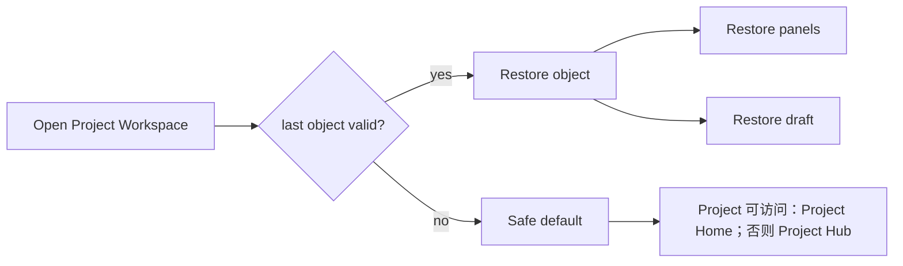
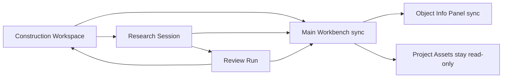

# UI 共用面板与交互附录

文档版本：v1.0
更新日期：2026-10-16
来源：`03_ui_workspace.md` v1.18 第 9 章；保留 P 编号，按模块拆分。

本附录与 [UI 主文](03_ui_workspace.md) 具有相同 UI 规范效力；需求含义和分期以 [01](01_functional_requirements.md) 为准，状态与不变量以 [02](02_domain_core.md) 及其专题附录为准。详细交互在本附录单点维护，主文只保留跨模块约束与索引。

## 1. 共用组件契约

本附录与 [主文](03_ui_workspace.md) 共同定义 UI 规范，组件不拥有 Project 知识或运行状态。布局由 [Shell 组合规则](03_ui_workspace.md#shell-composition) 统一约束。

| 组件 | 输入上下文 | 放置与操作边界 | 必须覆盖的反馈 |
| --- | --- | --- | --- |
| P14 空态/禁用态 | Project 状态、权限、可用 KV | 主体空态或操作旁提示，导航不产生写入 | 无知识、归档、不可访问、配置缺失 |
| P30 知识资产 | Project、用户权限、明确的 KV、可选引用焦点 | Project Assets；宽屏可展开覆盖层、窄屏单抽屉；仅查看和跳转 | 加载、无结果、缺失、越权、版本不匹配、引用过期 |
| P35 知识更新 | 最新已发布 KV、对象绑定 KV、稳定上下文与权限 | 非阻塞提示进入详情；创建关联新对象前确认 | 无更新、变化加载失败、不可启动、原对象保留 |
| P36 冲突/保护 | 操作、对象、后端原因、影响范围、内容来源 | 操作旁反馈或一次性对话框；仅提供适用动作 | 占槽、写入中、只读、缺版本、人工覆盖 |
| P37 高风险确认 | 具体 Project 操作、权限、实际影响范围 | Project Hub 触发对话框，确认后仍由后台校验 | 取消、提交中、防重复提交、失败与新状态 |
| P38/P39 恢复与切换 | 当前用户、Project、对象、草稿及面板状态 | Shell 协调；不推进业务状态 | 失效对象、安全回退、过期响应丢弃 |

打开引用时保留来源对象/绑定版本；切换对象后，旧请求结果不得混入新对象的资产或信息面板。Project Assets 与 Object Info 是同一辅助区域中的不同内容，引用打开时可切到 Assets，返回 Object Info 保留原对象。共用组件不新增业务权限，不展示不适用分期的动作。

## 2. 线框与交互

<a id="p14"></a>

### P14 Workspace 空态 / 禁用态

```text
┌────────────────────────────────────────────────────────────────────────────┐
│ Project A                                               active / archived │
├────────────────────────────────────────────────────────────────────────────┤
│                                                                            │
│                         ┌──────────────────────┐                           │
│                         │ Construction        │                           │
│                         │ [打开构建工作台]     │                           │
│                         └──────────────────────┘                           │
│                                                                            │
│                         ┌──────────────────────┐                           │
│                         │ Research Session     │                           │
│                         │ [需要可用 KV]        │                           │
│                         └──────────────────────┘                           │
│                                                                            │
│                         ┌──────────────────────┐                           │
│                         │ Review Run           │                           │
│                         │ [需要可用 KV]        │                           │
│                         └──────────────────────┘                           │
│                                                                            │
└────────────────────────────────────────────────────────────────────────────┘
```

<a id="p30"></a>

### P30 ProjectKnowledgeAssetPanel

```text
┌────────────────────────────────────────────────────────────────────────────┐
│ Project Knowledge Assets              Project KV: KV-13 | Object KV: KV-12│
├────────────────────────────────────────────────────────────────────────────┤
│ [Papers] [Materials] [Graph] [Version]   引用跳转: RS-023 / paper A / passage 3 │
├──────────────────────────────┬─────────────────────────────────────────────┤
│ 论文库只读列表                │ 论文详情 / Graph 焦点                       │
│ 搜索 标题/摘要/作者           │ ┌─────────────────────────────────────────┐ │
│ 来源 ▼ 评分 ▼ 有效性 ▼ 引用 ▼ │ │ 标题 / 作者 / 年份 / DOI / arXiv ID     │ │
│ ┌──────────────┬────┬──────┐ │ │ 评分 / 有效性 / 引用状态 / 文本来源     │ │
│ │ 标题          │ 分 │ 操作 │ │ │ 摘要 / 一句话总结 / 亮点 / 方法与创新  │ │
│ │ paper A      │9.1 │ 查看 │ │ │ [打开 PDF] [远程访问] [打开 Graph 节点]│ │
│ │ paper B      │7.2 │ 查看 │ │ └─────────────────────────────────────────┘ │
│ └──────────────┴────┴──────┘ │ ┌─────────────────────────────────────────┐ │
│                              │ │ Graph 只读视图: Paper / Author / Method │ │
│                              │ │ ○──○──○  节点详情 / 关系边 / 引用来源   │ │
│                              │ └─────────────────────────────────────────┘ │
├──────────────────────────────┴─────────────────────────────────────────────┤
│ 安全空态: PDF 缺失 / Graph 节点缺失 / 越权 / 版本不匹配 / 引用过期时展示原因 │
└────────────────────────────────────────────────────────────────────────────┘
```

知识资产面板只读取当前 Project、当前用户权限和指定 Knowledge Version 范围内的论文、Project 资料、文件访问引用、Graph 投影和引用证据。Materials 使用资料标题/content_format/处理状态筛选，详情显示重要摘要、来源与鉴权文件入口；不在只读面板提供补充或移除操作。论文详情与 Graph 互跳只改变查看焦点，不触发任何写操作。

<a id="p35"></a>

### P35 知识更新与研究证据范围

```text
┌──────────────────────────────────────────────────────────────┐
│ 知识更新                                                [×]   │
├──────────────────────────────────────────────────────────────┤
│ 项目最新已发布版本 KV-13   当前对象绑定 KV-12                 │
│ 当前文献范围：截止时间 / 已固定（如适用）                    │
│ 变化：新增 12 / 修正 2 / 排除 1 / 降级 1 / 失败 0            │
│ [查看变化清单]  尚未分析具体结论影响                         │
│                                                              │
│ 对象       绑定版本    运行状态    文献范围                   │
│ RS-023     KV-12       active      固定                      │
│ RV-008     KV-12       inactive    有更新可查看               │
│ 原对象与人工修改保留；新构建仍基于项目最新已发布版本         │
│                                                              │
│ [稍后查看] [固定当前文献范围]                                │
│ [基于最新知识继续研究] [基于最新文献创建新版综述]             │
└──────────────────────────────────────────────────────────────┘
```

- 更新提示在发布后即可出现，采用非阻塞方式，不等待最后一个 active 对象结束。各对象可独立选择；固定文献范围停止重复升级催促，但保留版本、截止时间及重要更正/撤稿提示。
- “基于最新知识继续研究”确认目标版本和已保存上下文范围后创建关联新 Session，原会话不切换绑定。旧结论标为待复核背景；active 对象只取已保存稳定内容，不读取流式半成品。
- “基于最新文献创建新版综述”属于 FR-018 的 P0 专用路径：确认前展示目标版本、从头生成范围、成本、输入继承及人工修改处理方式；创建独立 Run/运行结果，原稿保留。通用重跑仍为 P1，Review 内差异回退仍为 P2。
- 新建独立对象不要求原对象停止运行；是否允许启动仍由权限、Project 状态及资源可用性检查决定。不要提供批量原地“刷新可用对象”。
- 新构建默认使用启动时最新已发布版本；旧依赖不弹出构建阻断确认。启用自动更新的授权包括配置范围内持续构建，不包括迁移旧研究或覆盖人工内容。
- 变化清单区分新增、修正、排除、降级和失败；项目范围排除与撤稿/更正分开。关联影响未分析时仅标“可能相关”。详细章节/回答影响分析是后续独立任务方向，不在此线框承诺已完成分析或提升为 P0。
- 规则依据：[FR-018](01_functional_requirements.md#fr-018-知识库并行更新与研究证据范围) 与 [领域附录](02-02_construction_versioning_appendix.md)。当前授权规则替代 D01 原待决策略，历史记录不作为现行门槛。

<a id="p36"></a>

### P36 冲突 / 覆盖 / 锁定

旧对象绑定历史版本本身不是冲突。历史引用打开原版本证据；撤稿、更正和权限变化附加明确提示。工作区恢复保留原对象与阅读位置，导出显示固定的稿件与文献范围。不可访问时展示原因，不跳到新证据替代；发布、导出和文件访问的权限由后台重新校验。

```text
┌──────────────────────────────────────────────────────────────┐
│ 当前操作不可执行                                      [×]    │
├──────────────────────────────────────────────────────────────┤
│ ○ 构建槽已占用（包括 paused Run）                            │
│ ○ 当前回复正在生成                                           │
│ ○ 当前章节正在写入                                           │
│ ○ 人工修改内容需要覆盖确认                                   │
│ ○ 当前无可用 Knowledge Version                               │
│ ○ archived Project 只读                                      │
│                                                              │
│ 影响对象                                                     │
│ ┌──────────────────────────────────────────────────────────┐ │
│ └──────────────────────────────────────────────────────────┘ │
│                                                              │
│ [关闭] [查看对象] [确认覆盖] [稍后处理]                       │
└──────────────────────────────────────────────────────────────┘
```

P36 每次只展示当前操作的具体原因，线框中的原因是状态示例，不是供用户选择的选项。按钮按下表裁剪，不得把确认当作绕过限制的授权。

| 原因 | 可展示动作 | 禁止行为 |
| --- | --- | --- |
| 构建槽占用 | 关闭、查看占槽 Run | 确认后启动第二个写入者；P0 不提供通用恢复/重跑 |
| 回复/章节写入中 | 关闭、查看对象；支持的取消入口由对象用例提供 | 用确认覆盖绕过写入锁 |
| 人工修改覆盖风险 | 取消、查看差异；后台允许时确认具体覆盖范围 | 静默覆盖；用同意覆盖豁免其他权限或锁 |
| 无可用 KV | 关闭、打开 Construction Workspace | 强行创建 Research/Review |
| Project archived / 无权限 | 关闭、返回可访问入口 | 继续写入或确认覆盖 |

<a id="p37"></a>

### P37 Project 高风险确认

```text
┌──────────────────────────────────────────────────────────────┐
│ 确认操作                                               [×]   │
├──────────────────────────────────────────────────────────────┤
│ 操作: Project 归档 / Project 软删除 / Project 私人资产清理    │
│ 对象: 当前 Project                                           │
│                                                              │
│ 影响范围                                                     │
│ ┌──────────────────────────────────────────────────────────┐ │
│ │ 私人运行记录 / Project-Paper 关联 / PDF / Graph / 导出保留 │ │
│ └──────────────────────────────────────────────────────────┘ │
│                                                              │
│ 输入名称确认                                                 │
│ ┌──────────────────────────────────────────────────────────┐ │
│ └──────────────────────────────────────────────────────────┘ │
│                                                              │
│ [取消]                                      [确认执行]       │
└──────────────────────────────────────────────────────────────┘
```

Run/Session 归档、删除和跨类型统一实例操作属于后续增强，不进入 P0 主线框。

<a id="p38"></a>

### P38 上下文恢复



<a id="p39"></a>

### P39 Workspace 对象切换



## 3. 更改记录

| 版本 | 日期 | 变更摘要 |
| --- | --- | --- |
| v1.0 | 2026-10-16 | 从 UI v1.18 拆分，保留页面标识与交互边界，补充布局组合并清理分期残留 |
