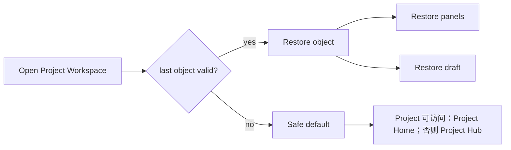
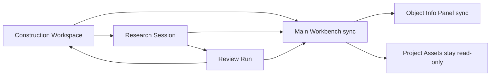

# UI 共用面板与交互附录

文档版本：v1.8
更新日期：2026-11-04
来源：`03_ui_workspace.md` v1.18 第 9 章；保留 P 编号，按模块拆分。

本附录与 [UI 主文](03_ui_workspace.md) 具有相同 UI 规范效力；需求含义和分期以 [01](01_functional_requirements.md) 为准，状态与不变量以 [02](02_domain_core.md) 及其专题附录为准。详细交互在本附录单点维护，主文只保留跨模块约束与索引。

## 1. 共用组件契约

本附录与 [主文](03_ui_workspace.md) 共同定义 UI 规范，组件不拥有 Project 知识或运行状态。布局由 [Shell 组合规则](03_ui_workspace.md#shell-composition) 统一约束。

| 组件 | 输入上下文 | 放置与操作边界 | 必须覆盖的反馈 |
| --- | --- | --- | --- |
| P14 空态/禁用态 | Project 状态、权限、可用 KV | 主体空态或操作旁提示，导航不产生写入 | 无知识、归档、不可访问、配置缺失 |
| P30 知识资产 | Project、用户权限、明确的 KV、可选引用焦点 | Project Assets；宽屏可展开覆盖层、窄屏单抽屉；仅查看和跳转 | 加载、无结果、缺失、越权、版本不匹配、引用过期 |
| P35 知识更新 | 项目最新已发布 KV、操作证据版本、当前权限 | 研究与综述各自在工作台内提示，可独立查看变化 | 无更新、变化加载失败、历史证据受限 |
| P36 冲突/保护 | 操作、对象、后端原因、影响范围、内容来源 | 操作旁反馈或一次性对话框；仅提供适用动作 | 占槽、写入中、只读、缺版本、人工覆盖 |
| P37 高风险确认 | 具体 Project 操作、权限、实际影响范围 | Project Hub 触发对话框，确认后仍由后台校验 | 取消、提交中、防重复提交、失败与新状态 |
| P38/P39 恢复与切换 | 当前用户、Project、对象、草稿及面板状态 | Shell 协调；不推进业务状态 | 失效对象、安全回退、过期响应丢弃 |

打开引用时保留来源对象/绑定版本；切换对象后，旧请求结果不得混入新对象的资产或信息面板。Project Assets 与 Object Info 是同一辅助区域中的不同内容，引用打开时可切到 Assets，返回 Object Info 保留原对象。共用组件不新增业务权限，不展示不适用分期的动作。

## 2. 线框与交互

<a id="p14"></a>

### P14 Workspace 空态 / 禁用态

```text
┌────────────────────────────────────────────────────────────────────────────┐
│ Project A                                               active / archived │
├────────────────────────────────────────────────────────────────────────────┤
│                                                                            │
│                         ┌──────────────────────┐                           │
│                         │ Construction        │                           │
│                         │ [打开构建工作台]     │                           │
│                         └──────────────────────┘                           │
│                                                                            │
│                         ┌──────────────────────┐                           │
│                         │ Research Session     │                           │
│                         │ [需要可用 KV]        │                           │
│                         └──────────────────────┘                           │
│                                                                            │
│                         ┌──────────────────────┐                           │
│                         │ Review Run           │                           │
│                         │ [需要可用 KV]        │                           │
│                         └──────────────────────┘                           │
│                                                                            │
└────────────────────────────────────────────────────────────────────────────┘
```

<a id="p30"></a>

### P30 ProjectKnowledgeAssetPanel

```text
┌────────────────────────────────────────────────────────────────────────────┐
│ Project Knowledge Assets              Project KV: KV-13 | Evidence KV: KV-12│
├────────────────────────────────────────────────────────────────────────────┤
│ [Papers] [Materials] [Graph] [Version]   引用跳转: RS-023 / paper A / passage 3 │
├──────────────────────────────┬─────────────────────────────────────────────┤
│ 论文库只读列表                │ 论文详情 / Graph 焦点                       │
│ 搜索 标题/摘要/作者           │ ┌─────────────────────────────────────────┐ │
│ 来源 ▼ 评分 ▼ 有效性 ▼ 引用 ▼ │ │ 标题 / 作者 / 年份 / DOI / arXiv ID     │ │
│ ┌──────────────┬────┬──────┐ │ │ 评分 / 有效性 / 引用状态 / 文本来源     │ │
│ │ 标题          │ 分 │ 操作 │ │ │ 摘要 / 一句话总结 / 亮点 / 方法与创新  │ │
│ │ paper A      │9.1 │ 查看 │ │ │ [打开 PDF] [远程访问] [打开 Graph 节点]│ │
│ │ paper B      │7.2 │ 查看 │ │ └─────────────────────────────────────────┘ │
│ └──────────────┴────┴──────┘ │ ┌─────────────────────────────────────────┐ │
│                              │ │ Graph 只读视图: Paper / Author / Method │ │
│                              │ │ ○──○──○  节点详情 / 关系边 / 引用来源   │ │
│                              │ └─────────────────────────────────────────┘ │
├──────────────────────────────┴─────────────────────────────────────────────┤
│ 安全空态: PDF 缺失 / Graph 节点缺失 / 越权 / 版本不匹配 / 引用过期时展示原因 │
└────────────────────────────────────────────────────────────────────────────┘
```

知识资产面板只读取当前 Project、当前用户权限和指定 Knowledge Version 范围内的论文、Project 资料、文件访问引用、Graph 投影和引用证据。Materials 使用资料标题/content_format/处理状态筛选，详情显示重要摘要、来源与鉴权文件入口；不在只读面板提供补充或移除操作。论文详情与 Graph 互跳只改变查看焦点，不触发任何写操作。

#### P30 引用定位与状态展示

引用打开时显示来源对象、原绑定版本及文本来源；正文/图谱定位只使用原证据。正常历史引用显示“历史版本”，不显示失效警报。当前风险与访问状态独立呈现：撤稿/更正可与可读证据同时存在；临时故障提示重试原引用；凭据过期重新鉴权；无权限或缺失按安全规则显示空态。不要显示统一的“引用有效”绿标暗示结论正确。

“查看最新版”进入独立浏览上下文，保留返回原引用入口，不能替换原引用或改变在途操作的证据版本。目标版本重新引用按 [领域 §2.6](02-02_construction_versioning_appendix.md#26-引用有效性与跨版本重新引用)，未复核的旧结论明确标记背景；不显示自动迁移/跨 Project 导入按钮。


<a id="p35"></a>

### P35 知识更新与研究证据范围

研究工作台和综述工作台分别在当前模块内展示轻量提示“检测到知识库版本更新”，旁边提供可选的“查看变化”。提示不抢焦点、不弹出确认框，输入、滚动位置、未保存稿件和流式输出保持原状。查看、忽略或关闭提示均不改变下一次操作的版本。重复收到同一 Project 和版本的发布事件只提示一次；失败、候选准备中及 no_change 均不产生此提示。

- 研究：V1 回复正在流式生成时发布 V2，本轮继续显示 V1。原 Session 的下一条提问自动使用受理时的最新发布版，回复及引用标注实际版本。
- 综述：V1 章节正在生成或审查时发布 V2，该任务继续使用 V1。原 Review Run 的下一次大纲、章节、终稿生成或审查自动使用受理时的最新发布版。显示任务或内容修订的证据版本，已有正文、确认及引用保留原记录。
- 查看变化时固定比较的两个版本，展示新增、修正、排除、降级和失败；撤稿或更正风险单独显示。未分析的结论影响保持未知。出现 V3 时不替换正在看的 V1→V2 比较。
- P30 保留历史知识版本、原始引用和文件修订的独立浏览入口。卡片展示 Project、版本 ID、发布时间、成员与范围摘要，区分本次检索窗口和累计成员范围；未知字段显示未知。打开卡片不改变当前编辑或下一次新任务的读取规则。归档项目及已完成对象仍遵守只读限制。

依据：[FR-018](01_functional_requirements.md#fr-018-知识库并行更新与研究证据范围) 与[领域附录](02-02_construction_versioning_appendix.md)。

<a id="p36"></a>

### P36 冲突 / 覆盖 / 锁定

既有回答、章节或审查使用历史证据时可正常查看。历史引用打开原版本证据；撤稿、更正和权限变化附加明确提示。工作区恢复保留原对象与阅读位置，导出显示固定的稿件与文献范围。不可访问时展示原因，不跳到新证据替代；发布、导出和文件访问的权限由后台重新校验。

```text
┌──────────────────────────────────────────────────────────────┐
│ 当前操作不可执行                                      [×]    │
├──────────────────────────────────────────────────────────────┤
│ ○ 构建槽已占用（包括 paused Run）                            │
│ ○ 当前回复正在生成                                           │
│ ○ 当前章节正在写入                                           │
│ ○ 人工修改内容需要覆盖确认                                   │
│ ○ 当前无可用 Knowledge Version                               │
│ ○ archived Project 只读                                      │
│                                                              │
│ 影响对象                                                     │
│ ┌──────────────────────────────────────────────────────────┐ │
│ └──────────────────────────────────────────────────────────┘ │
│                                                              │
│ [关闭] [查看对象] [确认覆盖] [稍后处理]                       │
└──────────────────────────────────────────────────────────────┘
```

P36 每次只展示当前操作的具体原因，线框中的原因是状态示例，不是供用户选择的选项。按钮按下表裁剪，不得把确认当作绕过限制的授权。

| 原因 | 可展示动作 | 禁止行为 |
| --- | --- | --- |
| 构建槽占用 | 关闭、查看占槽 Run、登记下轮请求（不占槽）；在既定分期和权限允许时，对 paused Run 显示继续、取消或重跑 | 确认后启动第二个写入者；继续必须沿用原实例及原槽，等待态暂停后继续回到原等待项；重跑撤销旧写资格并将旧 Run cancelled 后安全交接，不允许第三方抢占 |
| 回复/章节写入中 | 关闭、查看对象；支持的取消入口由对象用例提供 | 用确认覆盖绕过写入锁 |
| 人工修改覆盖风险 | 取消、查看差异；后台允许时确认具体覆盖范围 | 静默覆盖；用同意覆盖豁免其他权限或锁 |
| 无可访问已发布 KV | 关闭、打开 Construction Workspace；空版可新建 Research/Review | 无版本强行创建或悄悄切换历史版本 |
| Project archived / 无权限 | 关闭、返回可访问入口 | 继续写入或确认覆盖 |

<a id="p37"></a>

### P37 Project 高风险确认

```text
┌──────────────────────────────────────────────────────────────┐
│ 确认操作                                               [×]   │
├──────────────────────────────────────────────────────────────┤
│ 操作: Project 归档 / Project 软删除 / Project 私人资产清理    │
│ 对象: 当前 Project                                           │
│                                                              │
│ 影响范围                                                     │
│ ┌──────────────────────────────────────────────────────────┐ │
│ │ 私人运行记录 / Project-Paper 关联 / PDF / Graph / 导出保留 │ │
│ └──────────────────────────────────────────────────────────┘ │
│                                                              │
│ 输入名称确认                                                 │
│ ┌──────────────────────────────────────────────────────────┐ │
│ └──────────────────────────────────────────────────────────┘ │
│                                                              │
│ [取消]                                      [确认执行]       │
└──────────────────────────────────────────────────────────────┘
```

Run/Session 归档、删除和跨类型统一实例操作属于后续增强，不进入 P0 主线框。

<a id="p38"></a>

### P38 上下文恢复



<a id="p39"></a>

### P39 Workspace 对象切换



## 3. 更改记录

| 版本 | 日期 | 变更摘要 |
| --- | --- | --- |
| v1.0 | 2026-10-16 | 从 UI v1.18 拆分，保留页面标识与交互边界，补充布局组合并清理分期残留 |
| v1.1 | 2026-10-16 | 补充 paused 构建槽可用控制及继续沿用原实例、重跑新实例接管规则 |
| v1.2 | 2026-10-16 | 同步无变化成功不触发更新提示、排队不占槽及暂停继续/重跑交接的交互约束 |

本次修订 v1.3（2026-10-16）：增加历史引用分层状态与任务导向版本卡片、显式选择交互。

### 空版本与已入库内容只读

空版本正常展示 0 个成员、无项目证据提示及新建 Research/Review 入口，不当作不可用版本。用户可导入资料或独立浏览可访问历史版本，系统不隐式回退。Research 空检索沿用显式继续无证据流程；Review 展示建议但不设置引用覆盖率门槛。

论文与 ProjectMaterial 的知识详情均只读；修改引导进入 Construction 的移除—新导入流程，不在只读资产面板直接写入。单条/批量/全部移除的风险确认及冲突构建交接统一由 Construction 承载，旧引用依赖不成为移除否决条件。

本次修订 v1.4（2026-10-16）：落实 R1-A 至 R4-A 与人工补充裁决：学术引用建议、轻量稿件编辑及下载、风险确认移除、空版本可新建研究、论文及资料入库后只读、筛选等待点追加词。仅设计同步，未实现或运行验收。

## A05 受限资料与历史提示

资料来源面板展示04-01 §10的只读MaterialProvenance，区分本次主动文字、历史自动取用、上传、检索、派生与未知；这些标签不能由用户切换为免检。可信本次主动文字在当前主体、Project及本次命令范围内使用时，不额外弹分类确认；不据此标为公开或修改原分类。本次输入例外仅绑定当前提交，历史自动取用/草稿及上传文件不能沿用，派生结果仍检查全部来源依赖。派生依赖不全、分类未确认或未知来源明确提示，不能以“无引用”显示为公开。

MaterialUseNotice词汇供后续受控读取接口消费：私人来源提示“当前设置不允许使用私人资料”；文件/检索及历史来源未确认时提示先确认分类；可信本次主动文字按上述例外直接供本任务使用；未知/依赖不全提示无法证明可用范围；必须使用受限历史时明确阻断，保留历史而不静默剪消息；允许子集检索标注“当前权限限制了可用范围”，不隐式换KnowledgeVersion、不报告为完整知识库没有资料。可跳转已有设置/分类详情，由用户明确操作后沿原合法入口继续；不新增通用retry/rerun。字段载体在A06/A07收口，本次未实现页面。

## A07 等待、预览与事件恢复交互

Task面板按[04-02](04-02_transport_task_file_contracts.md)的target_location定位既有页面，展示TaskWaitingRef的当前动作；打开后读取详情取得最新修订/确认，不从历史SSE或Workspace恢复草稿提取token。只显示后端允许且已实现的动作，禁用原因使用安全说明；过时或无权引用刷新所属对象，不猜通用重试入口。技术succeeded与“内容待确认”分别显示，done不把Review Run/Session标为业务完成。

P36/P37按[04-01 §1.1–1.2](04-01_p0_operation_contracts.md#11-confirmationpreview具名影响与保留项a07设计)逐项展示影响与保留范围：人工覆盖显示目标及修订；终止显示确切冲突执行；关联移除与私人清理分别描述。protected_scope只作保留说明，不能遮蔽必须同意的影响对象。账号管理员只看治理摘要；没有权限不展示私人ID/标题/链接。blocked_reasons非空不允许提交；token过期/依据变化按已有安全错误重新预览，保留用户草稿但不自动确认。普通保存不额外增加确认窗。

研究或综述工作台收到发布事件时，由 P35 就地提示版本变化；后续操作无需确认版本。首次无受保护稿的终稿汇总保留原有直接入口，不新增二次确认。

重连先隔离旧连接代次，读Task和适用output恢复完整生成缓冲/引用/警告/资料提示，再从对应游标订阅；人工编辑区不被恢复文本覆盖。新流校验Task/attempt/Project/KV/target、去重及顺序；异常重新读快照，不自动重生成。资料提示使用A05安全词汇，允许子集不显示“完整库无资料”，必需历史受限显示错误并保留原内容；合法人工历史读取不被Agent私人模式误隐藏。

本节为交互契约，未实现组件或浏览器验收；具体反例与追踪见task010 TC-01–12及09。
